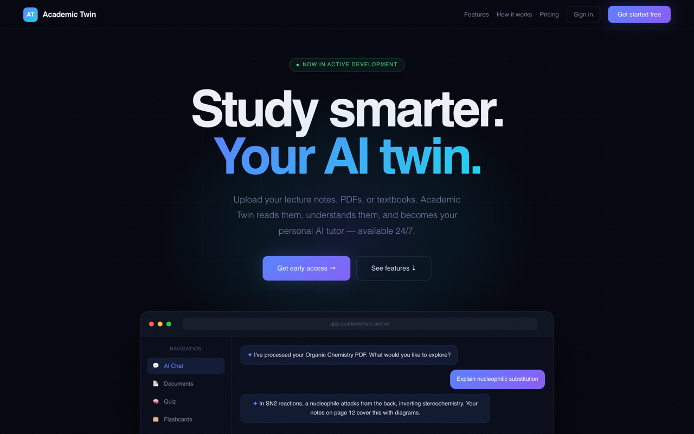

# 🧠 Academic Twin — AI-Powered Personalized Learning Platform

An intelligent study companion that understands your uploaded materials, tracks progress, and provides personalized academic assistance powered by RAG over Llama 3.3 70B.

<p align="center">
  <a href="https://academic-twin-rouge.vercel.app"><b>Live demo →</b></a>
</p>

<p align="center">
  
</p>

---

## ✨ Features

| Feature | Description |
|---|---|
| 📄 Document Upload | Upload PDFs, text files, and notes |
| 🤖 AI Chat (RAG) | Chat with your materials — answers cite sources |
| 📝 Quiz Generator | MCQ, Short Answer, True/False — AI-generated |
| 🃏 Flashcards | Auto-generated with spaced repetition |
| 📋 Smart Summaries | Chapter summaries, revision sheets, key points |
| 📊 Analytics | Study time, quiz scores, weak topic detection |
| 🗓️ Study Planner | AI-recommended daily schedules |

---

## 🚀 Quick Start

### 1. Clone and install

```bash
git clone https://github.com/Dznzx/academic-twin-2
cd academic-twin-2
npm install
```

### 2. Set up environment variables

```bash
cp .env.example .env.local
# Fill in your API keys (see below)
```

### 3. Set up database

```bash
npx prisma generate
npx prisma db push
```

### 4. Run the dev server

```bash
npm run dev
```

Open [http://localhost:3000](http://localhost:3000)

---

## 🔑 Required API Keys

| Service | Purpose | Get it at |
|---|---|---|
| **Clerk** | Authentication | [clerk.com](https://clerk.com) |
| **Groq** | Llama 3.3 70B inference | [console.groq.com](https://console.groq.com) |
| **Google AI** | text-embedding-004 | [aistudio.google.com](https://aistudio.google.com) |
| **Pinecone** | Vector database | [pinecone.io](https://pinecone.io) |
| **Supabase** | PostgreSQL + Storage | [supabase.com](https://supabase.com) |

---

## 📁 Project Structure

```
src/
├── app/
│   ├── page.tsx              # Landing page
│   ├── dashboard/            # Main dashboard
│   ├── chat/                 # AI chat interface
│   ├── upload/               # Document management
│   ├── quiz/                 # Quiz generation & taking
│   ├── flashcards/           # Flashcard study mode
│   ├── analytics/            # Learning analytics
│   ├── study-planner/        # Study planner
│   ├── auth/                 # Login / Register
│   └── api/                  # All API routes
│       ├── documents/        # CRUD + summarize
│       ├── chat/             # Streaming RAG chat
│       ├── quiz/             # Generate + attempt
│       ├── flashcards/       # Generate + review
│       ├── analytics/        # User stats
│       └── study-planner/    # Plans + tasks
├── components/
│   ├── layout/               # Sidebar, header
│   ├── ui/                   # Button, Card, Badge, etc.
│   └── upload/               # DocumentCard
├── lib/
│   ├── ai/                   # LLM clients, Pinecone, RAG, generators
│   ├── db/                   # Prisma client
│   └── utils/                # Helpers
├── hooks/                    # useDocuments, useAnalytics
├── types/                    # Shared TypeScript types
└── styles/                   # Global CSS
```

---

## 🏗️ Architecture

```
Student
   │
   ▼
Next.js Frontend (React + Tailwind)
   │
   ▼
Next.js API Routes (server-side)
   │
   ├─── Clerk Auth ──────────────► User DB (Postgres/Supabase)
   │
   ├─── PDF Processing ──────────► Text Extraction (pdf-parse)
   │                                       │
   │                               Text Chunking (LangChain)
   │                                       │
   │                               Google Embeddings
   │                                       │
   │                               Pinecone Vector DB
   │
   └─── AI Services ─────────────► Groq · Llama 3.3 70B
            ├── RAG Chat (streaming)
            ├── Quiz Generator
            ├── Flashcard Generator
            └── Summarizer
```

---

## 🛠️ Tech Stack

- **Frontend**: Next.js 14, React, TypeScript, Tailwind CSS, Radix UI
- **Backend**: Next.js API Routes, Node.js
- **Database**: PostgreSQL via Supabase, Prisma ORM
- **AI**: Groq (Llama 3.3 70B), Google text-embedding-004, LangChain
- **Vector DB**: Pinecone
- **Auth**: Clerk
- **Storage**: Supabase Storage
- **Deployment**: Vercel + Supabase

---

## 📦 Deployment

### Deploy to Vercel

```bash
npm install -g vercel
vercel --prod
```

Add all environment variables from `.env.example` to your Vercel project settings.

### Supabase setup

1. Create a new Supabase project
2. Copy the `DATABASE_URL` from Settings → Database
3. Create a storage bucket named `documents`
4. Run `npx prisma db push` with your production `DATABASE_URL`

---

## 🔮 Future Roadmap

- [ ] Voice-based AI tutoring
- [ ] OCR for handwritten notes
- [ ] AI-generated mind maps
- [ ] Collaborative study groups
- [ ] Multi-language support
- [ ] Mobile app (React Native)
- [ ] Teacher/classroom dashboard
- [ ] Calendar integration
- [ ] Learning streaks & gamification

---

## 📄 License

MIT — free to use, modify, and deploy.
